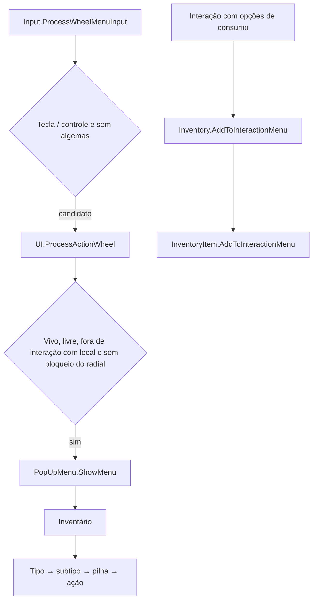
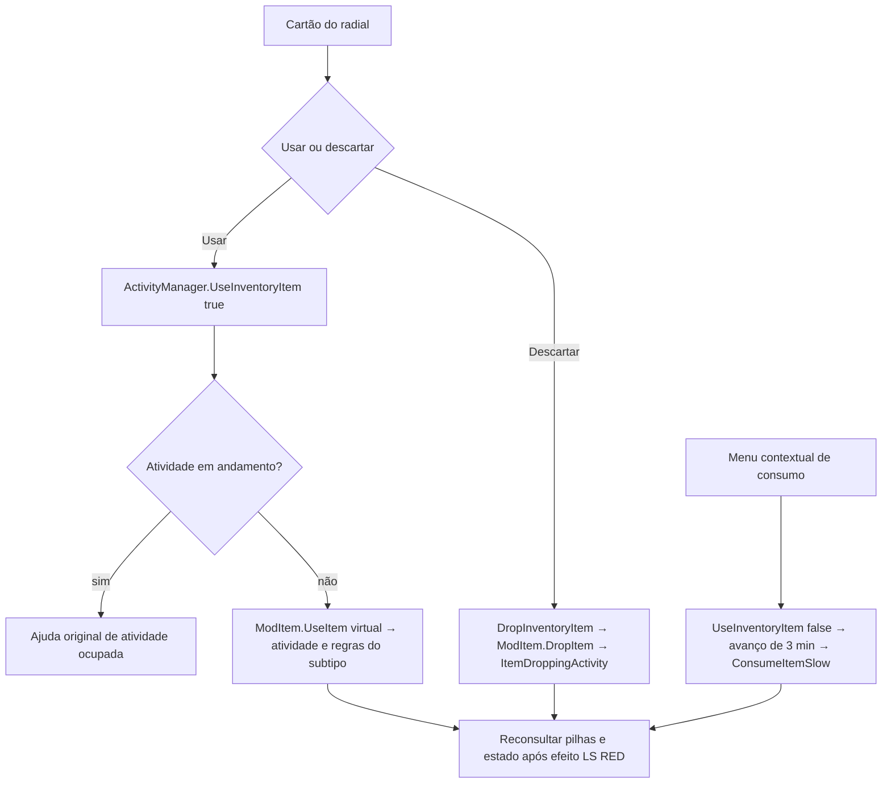

# Auditoria técnica da RC2

Referência `jholleboy/lossantosred-ptbr@ba4115b`. Os nomes de métodos e arquivos abaixo correspondem à revisão estática. O [índice de fontes](SOURCE_INDEX.md) aponta para o commit auditado. A configuração efetiva pode variar com XML, remapeamentos e plugins instalados.

## Inventário pessoal e abertura

`Player.Inventory` usa `Inventory.ItemsList` de `InventoryItem`. `Inventory.Get(ModItem)` compara `ModItem.Name`; `Add` registra definição ausente em `IModItems` e acumula `RemainingPercent`. `Amount` arredonda para cima, portanto uma unidade exibida pode conter só uma fração. `Use` aplica `PercentLostOnUse` ou remove uma unidade. Peso, slots físicos e limite global de carga não foram encontrados nessas operações. Quantidade total, quando exibida, precisa distinguir pilhas de unidades.

O radial usa `XButton1` ou `Alt esquerdo + N` de fábrica; o controle segue os mapeamentos em `KeySettings`. O prompt de interação usa `O` por padrão. `I` aparece em `VehicleShowcase` como tecla consultada por esse fluxo; também há uma ocorrência comentada em `BookingVehicleManager`. O atalho futuro deve ceder ao showcase, às telas nativas, ao radial, ao telefone, às interações em curso e a outros menus. Conflitos com binds personalizados, controles nativos remapeados ou plugins instalados exigem teste na máquina alvo.

O submenu do radial oferece descartar 1, tudo e 5 quando `Amount > 5`. A presença de “Usar” no radial não prova um efeito para a definição base. Consumo lento em menu de interação é uma ação diferente. Efeitos assíncronos não devem ser apresentados como concluídos no aceite da solicitação.

## Armazenamento

| Sistema | Abertura, acesso e operações | Capacidade e persistência |
| --- | --- | --- |
| Residência e apartamento | `Residence.CreateInventoryMenu` e menu da propriedade. `InventoryInteract.OnInteract` usa prompt original, câmera, deslocamento, início/fim de interação e animação. O ingresso pela residência usa `IsOwnedOrRented`, `CanInteract` e as condições do interior. O ponto escolhe itens, armas ou dinheiro e aplica listas de tipos permitidos/proibidos. | Três recipientes de `Residence`. `Residence.GetSaveData` e `SavedResidence` guardam/restauram os três. O vínculo é à propriedade, não ao texto do prompt. |
| Geladeira, despensa, prateleira, cômoda e outros pontos internos | Instâncias de `InventoryInteract` nos interiores, por exemplo as do apartamento em `Data/Location/Interiors.cs:7602`. | São vistas filtradas do armazenamento do local quando apontam ao mesmo `IInventoryableLocation`. A mesma pilha não deve virar dois depósitos. |
| Estabelecimento do jogador | `Business` mantém os três recipientes e oferece os menus do estabelecimento e de interior. `Payout` pode adicionar estoque/dinheiro independentemente da UI. | `SavedBusiness`; povoamento e saldo podem mudar enquanto o menu está aberto. |
| Veículo | `Player.ShowVehicleInteractMenu` exige veículo válido já ocupado pelo jogador ou de sua propriedade. `VehicleInteractionMenu.ShowInteractionMenu` monta “Inventário, dinheiro e armas”. Inicializa conteúdo aleatório pelos métodos do `VehicleExt`. No exterior, o submenu usa o osso de armazenamento próximo até 5 m para animação de porta; na cabine reutiliza os mesmos recipientes. O loop original exige entidade válida, velocidade até 0,5 e distância 2D até 7 m, além de jogador vivo/livre e menu aberto. | `VehicleExt.SimpleInventory`, `WeaponStorage`, `CashStorage`. `GameSave` captura e restaura a variante de veículo salvo. Busca policial e apreensão também removem itens/armas. O handle é transitório. |
| Porta-luvas | Acesso em veículo foi encontrado no mesmo menu e nos mesmos objetos de armazenamento. | Nenhum recipiente separado de porta-luvas foi identificado na RC2. |
| NPC | `PedExt.PedInventory` é `SimpleInventory`. `PedInspect` e `HoldUp` populam e tratam saque pelo fluxo do NPC. Comércio altera o inventário do NPC nos handlers de compra/venda. | Estado da entidade, sem caminho de save pessoal genérico identificado. Interação com NPC não concede acesso bilateral de depósito. |
| Facções e outros | `GangDen` abre `Transaction`; `DeadDrop`, saque, fabricação e serviços têm fluxos próprios que alteram bens ou dinheiro. Pontos de armazenamento de um local continuam sujeitos à implementação de `InventoryInteract`. | Não foi identificado um cofre bilateral genérico independente de facção. Investigar cada interação especializada antes de oferecer ações de armazenamento. |

Operações de itens comuns ficam em `ModItem.CreateInventoryManageMenu`: retirada remove do `SimpleInventory`, executa animação quando configurada e adiciona ao jogador; depósito faz o inverso. `UpdateInventoryScrollers` limita a seleção pelas quantidades e atualiza os dois lados. `Inventory.Remove` e `SimpleInventory.Remove` podem remover a pilha inteira quando a quantidade solicitada alcança ou excede o saldo exibido. Chamadas separadas de Remove/Add com yield e sem validação atual não constituem transação segura. Variações fracionárias exigem comparação com o efeito original, inclusive para a última unidade.

Armas passam por `StoredWeapon.CreateManagementMenu` e `WeaponStorage.PlaceInStorage/RemoveFromStorage`, incluindo estado de arma e variação. Dinheiro usa `CashStorage.CreateInteractionMenu` e os callbacks de depósito/retirada com dinheiro em mãos, passo configurado no scroller, verificação de saldo e `OnStoredCashChanged`. O depósito rejeita atingir ou superar $500.000.000. Não foi encontrado limite de peso/slots comum aos três recipientes.

## Comércio

`GameLocation.OnInteract` verifica fechamento e `CanInteract`. `StandardInteract` marca a interação, prepara câmera e preços variáveis, processa a transação e encerra menu, câmera e interior. A sessão do ElectroInventory deve viver dentro desse ciclo. O caminho especializado da loja pode agregar outras condições. No veículo, as permissões de porta vêm do fluxo original. A animação da porta não é uma autorização de armazenamento isolada.

| Família | Abertura e executor | Regras que precisam permanecer no LS RED |
| --- | --- | --- |
| Alimentação, bebidas, conveniência, farmácia, equipamentos e varejo | `GameLocation` e suas classes de local, incluindo conveniência, bar, restaurante, barraca, drive-thru, joalheria via catálogo, farmácia, liquor, hardware, sporting goods, head shop e dispensário. `Transaction.CreateTransactionMenu` cria `PurchaseMenu` e/ou `SellMenu` conforme as listas. | `ShopMenus`/XML e `ShopMenu.Items`; `ModItem.CreatePurchaseMenuItem/CreateSellMenuItem` selecionam quantidade e chamam os executores privados `PurchaseItem/SellItem`. Há compra direta, consumo no local, gratuidade e caminho de roubo conforme o contexto. |
| Máquinas, peões, mercado ilícito e vendedores | `VendingMachine`, `PawnShop`, `IllicitMarketplace`, `PersonTransaction`, `GangDen`, vendedores de rua e suas listas de desejos. | Distinguir mercadoria, demanda e saldo real do NPC; os contadores de `DesiredItem` podem substituir os da linha de catálogo. Preços variáveis e consentimento do vendedor são deliberados pelo jogo. `PersonTransaction.CanContinueConversation` exige jogador vivo/livre, NPC válido e apto a conversar, com alcance de 15 m. |
| Armas e munição | `GunStore` e `WeaponItem.CreatePurchaseMenuItem/CreateSellMenuItem`; handlers separados para arma e munição. | Estado e compatibilidade de arma, munição, preço, eventuais licenças e variações a partir do menu original. A operação genérica de pilhas não serve. |
| Veículos | `Dealership → Transaction → VehicleItem`; handlers de compra/venda próprios. | Preview, carro em mundo, cor, placa, entrega e propriedade. `ModShopMenu` usa orçamento/execução próprios para reparos e modificações. |
| Roupa, estética e serviços | `TryOnInteract → ClothingPurchaseMenu`; `SalonInteract → SalonPurchaseMenu`; tatuagem, hospital, hotéis, forger, postos, gambling e outros serviços usam transações especializadas ou fluxos próprios. | Diferenciar pagamento por serviço, alteração de aparência e aquisição de item. Preservar preview, câmera, condicionantes e resultado original. |
| Placas e operações singulares | `LicensePlateItem.CreateSimpleSellMenu` e menus de operações especiais. | Preço/filtro dependem do estado da placa e do local. Itens únicos e vendas de propriedade, oficina ou serviços não devem passar pelo executor genérico. |

`MenuItem` fornece preço de compra/venda, disponibilidade, mínimo, máximo e incremento, contadores e limite de compra/venda (`-1` significa ausência daquele limite). `ModItem` monta o detalhe e o preço por pacote e obtém estoque/demanda do contexto. `Transaction.OnItemPurchased/OnItemSold` atualiza a transação e dispara os efeitos e a apresentação próprios. `BankAccounts.GetMoney/GiveMoney(UseAccounts)` decide o saldo aplicável e o débito/crédito. Um scroller habilitado ou valor exibido pode ficar obsoleto. A ponte precisa consultar a cotação e o saldo no momento de executar, sem recalcular por conta própria. Estoque de menu e demanda de NPC não devem ser tratados como bens persistidos em todos os contextos.

## Persistência e fronteiras

`GameSave` captura itens pessoais como `InventorySave(ModItem.Name, RemainingPercent)`, e restaura resolvendo `ModItems.Get`. Armas nativas são salvas separadamente em `StoredWeapon` com hash, munição e variação. A lógica de casas e negócios passa por `SavedResidence` e `SavedBusiness`; a variante veicular leva listas próprias e dinheiro. O plugin futuro não escreverá os saves. Tradução, ordenação, ícones, posição de grade e IDs de sessão não fazem parte da identidade persistida.
